# The Definitive Guide to Tool Calling, Function Calling & Agentic Gateways

This guide explains how **Tool Calling** (Function Calling) works under the hood, how autonomous coding agents (**Cursor**, **Claude Code**, **Cline**, **Aider**) interact with LLMs, and how an **LLM Gateway** translates, streams, and secures these interactions.

---

## 1. Foundational Concept: How Agents Actually Work

### The Big Misconception
Many developers assume that when they use Claude Code or Cursor, the LLM itself is running terminal commands, navigating file trees, or modifying code directly on their machine.

**In reality: No LLM can run code, open files, or access the internet.** An LLM is strictly a text-in, text-out neural network that predicts the next most probable tokens.

### The Agentic Architecture: The Pilot and the Engine

An autonomous AI system consists of two distinct components:

1. **The Agent (The Host Program / Pilot)**:
   - A local application running on your computer (e.g., Cursor IDE, VS Code Extension like Cline, or a CLI tool like Claude Code).
   - Has access to your local operating system: file system (`fs.readFile`, `fs.writeFile`), terminal shells (`bash`, `zsh`, `cmd.exe`), and network tools.
2. **The LLM Gateway / Model (The Brain / Engine)**:
   - Evaluates the conversation, recognizes when it needs real-world data, and emits **structured instructions** telling the agent what tool to run and with what arguments.

```
┌────────────────────────────────────────────────────────────────────────┐
│                        YOUR LOCAL MACHINE                              │
│                                                                        │
│   ┌──────────────────────────────────────────────────────────────┐     │
│   │                     Agent (e.g., Cline / Cursor)             │     │
│   │                                                              │     │
│   │   Tools Available:                                           │     │
│   │   - read_file(path)                                          │     │
│   │   - write_file(path, content)                                │     │
│   │   - execute_bash(command)                                    │     │
│   └──────────────▲───────────────────────────────┬───────────────┘     │
│                  │                               │                     │
│    Executes Tool │                               │ Sends HTTP Request  │
│    Locally on OS │                               │ (Prompt + Tools)    │
│                  │                               ▼                     │
└──────────────────┼───────────────────────────────┼─────────────────────┘
                   │                               │
                   │               ┌───────────────▼──────────────┐
                   │               │      Our LLM Gateway         │
                   │               │      (:3001/v1)              │
                   │               └───────────────┬──────────────┘
                   │                               │
                   │                     Routes &  │ Streams Tokens
                   │                     Translates│
                   │                               ▼
                   │               ┌──────────────────────────────┐
                   │               │  Providers (Groq / Gemini)   │
                   │               └───────────────┬──────────────┘
                   │                               │
                   └───────────────────────────────┘
                     Returns JSON: "Please run execute_bash('git status')"
```

---

## 2. The 3-Step Lifecycle of a Tool Call

Every agentic loop follows an identical 3-step conversation pattern.

```mermaid
sequenceDiagram
    autonumber
    actor Dev as Developer
    participant Agent as Agent (Host OS)
    participant Gateway as LLM Gateway (:3001)
    participant Model as LLM (Gemini / Groq)

    Dev->>Agent: "Check git status and fix any syntax errors"
    
    rect rgb(24, 24, 27)
        Note over Agent,Model: Step 1: Request with Tool Declarations
        Agent->>Gateway: POST /v1/chat/completions (messages + tools schema)
        Gateway->>Model: Forward translated request
    end

    rect rgb(39, 39, 42)
        Note over Model,Agent: Step 2: Model Decisions (Tool Call Emission)
        Model-->>Gateway: tool_calls: [name: "execute_bash", args: { cmd: "git status" }]
        Gateway-->>Agent: Pass standard OpenAI tool_call
    end

    rect rgb(24, 24, 27)
        Note over Agent,Dev: Execution Step (Host Computer)
        Agent->>Agent: Local shell runs `git status` -> "modified: app.ts"
    end

    rect rgb(39, 39, 42)
        Note over Agent,Model: Step 3: Tool Result Feedback Loop
        Agent->>Gateway: POST /v1/chat/completions (role: "tool", content: "modified: app.ts")
        Gateway->>Model: Forward with full conversation history
        Model-->>Gateway: Final text: "You have uncommitted changes in app.ts."
        Gateway-->>Agent: Stream response to screen
    end
```



---

## 3. The OpenAI Wire Format (The Industry Standard)

Virtually all modern developer tools (Cursor, Cline, Aider, LangChain, AutoGen) use OpenAI's JSON specifications for tool calling.

### Step 1: The Request Payload (`tools` array)

The client sends its user messages along with a definition of all tools the agent can execute. Each tool is described using JSON Schema:

```json
{
  "model": "smart-chat",
  "messages": [
    {
      "role": "user",
      "content": "What files are in the current directory?"
    }
  ],
  "tools": [
    {
      "type": "function",
      "function": {
        "name": "run_bash",
        "description": "Execute a command in the local shell",
        "parameters": {
          "type": "object",
          "properties": {
            "command": {
              "type": "string",
              "description": "The command line string, e.g. 'ls -la' or 'dir'"
            }
          },
          "required": ["command"]
        }
      }
    }
  ],
  "tool_choice": "auto"
}
```

### Step 2: The Model's Response (`tool_calls`)

When the model decides to use a tool, it returns `content: null` and populates the `tool_calls` array. Notice that `arguments` is a **serialized JSON string**:

```json
{
  "id": "chatcmpl-91a8df",
  "object": "chat.completion",
  "created": 1740000000,
  "model": "smart-chat",
  "choices": [
    {
      "index": 0,
      "message": {
        "role": "assistant",
        "content": null,
        "tool_calls": [
          {
            "id": "call_01j7k8m9",
            "type": "function",
            "function": {
              "name": "run_bash",
              "arguments": "{\"command\":\"dir\"}"
            }
          }
        ]
      },
      "finish_reason": "tool_calls"
    }
  ]
}
```

### Step 3: The Tool Result Message (`role: "tool"`)

After the agent runs the command locally, it appends the result to the history and makes another API call. The `tool_call_id` must match the `id` from Step 2:

```json
{
  "model": "smart-chat",
  "messages": [
    {
      "role": "user",
      "content": "What files are in the current directory?"
    },
    {
      "role": "assistant",
      "content": null,
      "tool_calls": [
        {
          "id": "call_01j7k8m9",
          "type": "function",
          "function": {
            "name": "run_bash",
            "arguments": "{\"command\":\"dir\"}"
          }
        }
      ]
    },
    {
      "role": "tool",
      "tool_call_id": "call_01j7k8m9",
      "content": "apps  packages  package.json  turbo.json  README.md"
    }
  ]
}
```

---

## 4. How Providers Differ: What Adapters Must Translate

Different foundation models use completely different schemas for function calling. The gateway acts as a translation layer so the client only ever needs to speak standard OpenAI format.

### Comparative Schema Mapping

| Feature | OpenAI / Groq Format | Google Gemini Format | Anthropic Claude Format |
| :--- | :--- | :--- | :--- |
| **Tool Declaration** | `tools: [{ type: "function", function: { name, parameters } }]` | `tools: [{ functionDeclarations: [{ name, parameters }] }]` | `tools: [{ name, input_schema }]` |
| **Tool Call Output** | `message.tool_calls: [{ id, function: { name, arguments } }]` | `candidates[0].content.parts[0].functionCall: { name, args }` | `content: [{ type: "tool_use", id, name, input }]` |
| **Tool Result Input**| `{ role: "tool", tool_call_id: "...", content: "..." }` | `{ role: "user", parts: [{ functionResponse: { name, response } }] }` | `{ role: "user", content: [{ type: "tool_result", tool_use_id, content }] }` |

### Gemini Adapter Translation Mechanics

1. **Request Translation (OpenAI -> Gemini)**:
   ```typescript
   // Map OpenAI tools to Gemini functionDeclarations
   const geminiTools = req.tools?.map((tool: any) => ({
     functionDeclarations: [{
       name: tool.function.name,
       description: tool.function.description,
       parameters: tool.function.parameters
     }]
   }));
   ```

2. **History Translation (OpenAI -> Gemini)**:
   When an OpenAI message has `role: "tool"`, Gemini expects a `functionResponse` part:
   ```typescript
   if (msg.role === 'tool') {
     return {
       role: 'user',
       parts: [{
         functionResponse: {
           name: findFunctionNameById(msg.tool_call_id),
           response: { output: msg.content }
         }
       }]
     };
   }
   ```

3. **Response Translation (Gemini -> OpenAI)**:
   When Gemini returns a `functionCall`, map it to OpenAI's `tool_calls` structure:
   ```typescript
   if (part.functionCall) {
     return {
       role: 'assistant',
       content: null,
       tool_calls: [{
         id: `call_${Date.now()}`,
         type: 'function',
         function: {
           name: part.functionCall.name,
           arguments: JSON.stringify(part.functionCall.args)
         }
       }]
     };
   }
   ```

---

## 5. Streaming Tool Calls (`stream: true`)

When an agent requests real-time token streaming, tool calls do not arrive in a single packet. Instead, they arrive in fragmented **Server-Sent Events (SSE)** chunks:

```
data: {"choices":[{"delta":{"tool_calls":[{"index":0,"id":"call_99","function":{"name":"run_bash"}}]}}]}

data: {"choices":[{"delta":{"tool_calls":[{"index":0,"function":{"arguments":"{\"comm"}}]}}]}

data: {"choices":[{"delta":{"tool_calls":[{"index":0,"function":{"arguments":"and\":\""}}]}}]}

data: {"choices":[{"delta":{"tool_calls":[{"index":0,"function":{"arguments":"npm test\"}"}}]}}]}

data: {"choices":[{"delta":{},"finish_reason":"tool_calls"}]}

data: [DONE]
```

### How the Client Processes Streamed Tool Calls:
1. **Initialize Buffer**: On the first chunk containing a `tool_calls` index, record the `id` and `function.name`.
2. **String Concatenation**: On subsequent chunks, concatenate `delta.function.arguments` into an accumulator string.
3. **Parse on Completion**: When `finish_reason == "tool_calls"`, parse the accumulated JSON string (`JSON.parse(buffer)`) and invoke the local function.

---

## 6. Why This Makes Your Gateway Functionally Identical to OpenRouter

When developers purchase access through **OpenRouter**, **Portkey**, or **LiteLLM**:
- They receive a unified API key.
- They set their `OPENAI_BASE_URL` to the proxy.
- They use models interchangeably across vendors without changing application code.

### Gateway Feature Comparison

```
┌──────────────────────────────────────┬────────────────────┬────────────────────┐
│ Feature                              │ OpenRouter / SaaS  │ Our Custom Gateway │
├──────────────────────────────────────┼────────────────────┼────────────────────┤
│ OpenAI-Compatible Endpoints          │ Yes                │ Yes                │
│ Tool Calling / Function Calling      │ Yes                │ Yes                │
│ Real-Time SSE Token Streaming        │ Yes                │ Yes                │
│ Automatic Mid-Stream Failover        │ Proprietary        │ Built-in (Router)  │
│ Cost Markup                          │ ~5% - 20% margin   │ 0% (Direct at-cost)│
│ Private Telemetry in PostgreSQL      │ No (Stored on SaaS)│ 100% Owned Locally │
│ Custom RPM & Spend Caps per Key      │ Basic              │ Redis Sliding Win  │
└──────────────────────────────────────┴────────────────────┴────────────────────┘
```

---

## 7. How to Connect Any Terminal Agent to Our Gateway

Once tool calling is active, any tool can be pointed directly at your local or deployed instance:

### Option A: Cline (VS Code Extension)
1. Open Cline Settings -> API Provider.
2. Select **OpenAI Compatible**.
3. Set **Base URL**: `http://localhost:3001/v1`
4. Set **API Key**: `gw_live_your_gateway_key`
5. Set **Model ID**: `smart-chat` or `fast-chat`

### Option B: Aider (Terminal AI Pair Programmer)
```bash
export OPENAI_BASE_URL="http://localhost:3001/v1"
export OPENAI_API_KEY="gw_live_your_gateway_key"

aider --model openai/smart-chat
```

### Option C: Python Script / Custom Agent Loop
```python
from openai import OpenAI

client = OpenAI(
    base_url="http://localhost:3001/v1",
    api_key="gw_live_your_gateway_key"
)

response = client.chat.completions.create(
    model="smart-chat",
    messages=[{"role": "user", "content": "List repository files"}],
    tools=[{
        "type": "function",
        "function": {
            "name": "list_files",
            "description": "Lists workspace files",
            "parameters": {"type": "object", "properties": {}}
        }
    }]
)

print(response.choices[0].message.tool_calls)
```

---

## Summary Checklist for Full Gateway Agent Support

To ensure any coding agent runs seamlessly through the gateway:
- [x] **OpenAI Contract Compliance**: Support `/v1/chat/completions` with standard headers.
- [x] **SSE Streaming**: Pass through `text/event-stream` chunks with low latency.
- [x] **Key Authentication**: Hash and validate `gw_live_...` with Redis/in-memory TTL cache.
- [ ] **Tools Pass-through in Groq Adapter**: Pass `tools` and `tool_choice` directly to Groq.
- [ ] **Tools Translation in Gemini Adapter**: Map OpenAI `tools` to Gemini `functionDeclarations` and format `functionCall` outputs.
- [ ] **Request Logging**: Capture tool call names and token usage into BullMQ and PostgreSQL.

